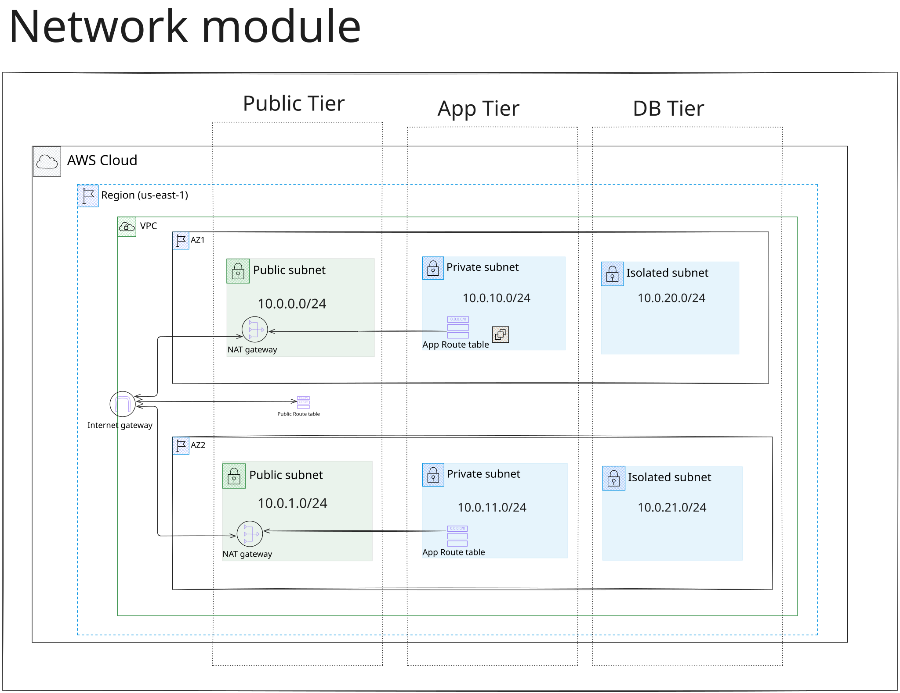

# AWS Three-Tier Architecture with Terraform


N-tier architecture is a classic way to design software systems. The application is split into separate tiers, typically presentation, application logic and data, and each tier has its own network boundary that controls what can reach it (ingress) and what it can reach (egress). This project walks step by step through implementing a three-tier application on AWS.

We use Terraform, an infrastructure-as-code (IaC) tool, to build the whole solution, so every resource below is declared in code, reviewed in pull requests and reproducible.

This is what we build, step by step: the network, then the app tier, then the database. Click the diagram to see it full size.


## Table of contents

- [1. The network layer](#1-the-network-layer)
  - [1.1 The VPC](#11-the-vpc)
  - [1.2 The subnets](#12-the-subnets)
  - [1.3 Internet access for the public subnets](#13-internet-access-for-the-public-subnets)
  - [1.4 NAT gateways for the private subnets](#14-nat-gateways-for-the-private-subnets)
  - [1.5 Routing the app subnets through the NAT](#15-routing-the-app-subnets-through-the-nat)
- [2. The app tier](#2-the-app-tier)
  - [2.1 The load balancer and its security group](#21-the-load-balancer-and-its-security-group)
  - [2.2 The listener and the target group](#22-the-listener-and-the-target-group)
  - [2.3 The app security group](#23-the-app-security-group)
  - [2.4 The instance role and the link to the database](#24-the-instance-role-and-the-link-to-the-database)
  - [2.5 The launch template](#25-the-launch-template)
  - [2.6 The Auto Scaling Group](#26-the-auto-scaling-group)
- [3. The database tier](#3-the-database-tier)
  - [3.1 The database security group](#31-the-database-security-group)
  - [3.2 The database subnet group](#32-the-database-subnet-group)
- [Good to know](#good-to-know)
- [Next steps](#next-steps)
- [How to run it](#how-to-run-it)
  - [1. Create the state bucket](#1-create-the-state-bucket)
  - [2. Deploy an environment](#2-deploy-an-environment)
  - [3. Check that it works](#3-check-that-it-works)
  - [4. Tear it down](#4-tear-it-down)

## 1. The network layer

The network is the foundation of the architecture: a VPC, subnets for each tier, and routing that decides what can reach what.



### 1.1 The VPC

Everything starts with the VPC, the private network that all three tiers live in (`modules/network/main.tf`):

```hcl
resource "aws_vpc" "vpc" {
  cidr_block           = var.vpc_cidr
  enable_dns_support   = true
  enable_dns_hostnames = true

  tags = { ... }
}
```

#### 1.1.1 The CIDR block

The VPC gets `10.0.0.0/16` (the default of the `vpc_cidr` variable): a private range of 65,536 addresses, `10.0.0.0` to `10.0.255.255`. The `/16` is the largest block AWS allows for a VPC, which leaves plenty of room to carve out subnets for all three tiers.

I split it into six `/24` subnets, two per tier, one in each of two Availability Zones. Terraform computes them with `cidrsubnet(var.vpc_cidr, 8, n)`, so the subnet ranges follow whatever range the VPC is given:

| Tier | AZ 1 | AZ 2 |
|---|---|---|
| public (ALB) | `10.0.0.0/24` | `10.0.1.0/24` |
| private (app) | `10.0.10.0/24` | `10.0.11.0/24` |
| isolated (db) | `10.0.20.0/24` | `10.0.21.0/24` |

Each tier starts at its own offset (0, 10 and 20), so the third octet shows which tier an address belongs to.

DNS support and DNS hostnames are both enabled so that resources in the VPC, such as the RDS endpoint, resolve by name.

### 1.2 The subnets

A subnet is a slice of the VPC's address range that lives in exactly one Availability Zone. A subnet cannot span AZs, but an AZ can hold many subnets. That is why each tier gets one subnet per AZ: losing an AZ takes out only half of each tier.

```hcl
resource "aws_subnet" "this" {
  for_each = local.subnets

  vpc_id            = aws_vpc.vpc.id
  cidr_block        = each.value.cidr_block
  availability_zone = each.value.az
  tags = { ... }
}
```

One resource block creates all six subnets. `local.subnets` is a map with one entry per subnet (`public-1`, `public-2`, `app-1`, and so on), holding its CIDR block, its AZ and its tier. `for_each` turns each entry into a subnet. The number of AZs is the `az_count` variable (default 2, minimum 2): the module takes the first `az_count` AZ names in the region, in sorted order, and creates one subnet per tier in each. Changing `az_count` changes the number of subnets, and everything built on them (ALB, Auto Scaling Group, route tables, and in prod the NAT gateways) follows it, without touching this block. The `Tier` tag records which tier a subnet belongs to.

### 1.3 Internet access for the public subnets

A subnet is not public by itself. It is public when its route table sends internet-bound traffic to an internet gateway. So the next step is an internet gateway for the VPC, a route table with a default route to it, and an association of that route table with the public subnets:

```hcl
resource "aws_internet_gateway" "igw" {
  vpc_id = aws_vpc.vpc.id

  tags = { ... }
}

resource "aws_route_table" "web-route-table" {
  vpc_id = aws_vpc.vpc.id

  route {
    cidr_block = "0.0.0.0/0"
    gateway_id = aws_internet_gateway.igw.id
  }

  tags = { ... }
}

resource "aws_route_table_association" "web-route-table-association" {
  for_each = local.public_subnets

  subnet_id      = aws_subnet.this[each.key].id
  route_table_id = aws_route_table.web-route-table.id
}
```

- The internet gateway belongs to the VPC, not to an AZ, and AWS runs it redundantly, so one gateway serves every public subnet.
- `0.0.0.0/0` is the default route: anything that doesn't match a more specific route, such as the VPC's own range, goes to the internet gateway.
- The association is what makes the subnets public. Only the two public subnets get this route table, so the app and db subnets have no path to the internet gateway.
- The route is necessary but not sufficient. The ALB, the only resource in the public subnets, is internet-facing and gets public addresses from AWS, and its security group allows port 80 from `0.0.0.0/0`.

### 1.4 NAT gateways for the private subnets

The app instances sit in private subnets with no route to the internet gateway, but they still need outbound access for package installs and updates. A NAT gateway provides it: it sits in a public subnet, has an Elastic IP, and lets instances in the private subnets start connections to the internet while nothing on the internet can start a connection to them.

```hcl
resource "aws_eip" "nat" {
  for_each = local.nat_subnets

  domain = "vpc"

  tags = { ... }
}

resource "aws_nat_gateway" "this" {
  for_each = local.nat_subnets

  allocation_id = aws_eip.nat[each.key].id
  subnet_id     = aws_subnet.this[each.key].id

  depends_on = [aws_internet_gateway.igw]

  tags = { ... }
}
```

#### 1.4.1 Cost against availability

A NAT gateway is one of the most expensive parts of this stack: it is billed for every hour it exists, plus for every GB that passes through it. It is also a zonal resource, so if its AZ goes down, every subnet routed through it loses outbound access. The `single_nat_gateway` variable lets each environment choose the trade-off:

| | `single_nat_gateway` | NAT gateways | Trade-off |
|---|---|---|---|
| dev | `true` | one, shared by all app subnets | cheapest; outbound access is lost if that AZ fails |
| prod | `false` | one per AZ | costs more; each AZ keeps its own outbound path, so an AZ failure doesn't affect the others |

The variable works through `local.nat_subnets`: with `true` it holds only the first public subnet, so one NAT gateway and one Elastic IP are created. With `false` it holds every public subnet.

### 1.5 Routing the app subnets through the NAT

A NAT gateway does nothing until a route points at it. Each app subnet gets its own route table, with a default route to the NAT gateway in the same AZ, and an association to attach it to the subnet:

```hcl
resource "aws_route_table" "app-route-table" {
  for_each = local.app_subnets

  vpc_id = aws_vpc.vpc.id

  route {
    cidr_block     = "0.0.0.0/0"
    nat_gateway_id = lookup(local.nat_gateway_by_az, each.value.az, local.fallback_nat_gateway_id)
  }

  tags = { ... }
}

resource "aws_route_table_association" "app-route-table-association" {
  for_each = local.app_subnets

  subnet_id      = aws_subnet.this[each.key].id
  route_table_id = aws_route_table.app-route-table[each.key].id
}
```

The `lookup` picks the NAT gateway in the subnet's own AZ, so traffic doesn't cross AZs when prod has one per AZ. If the AZ has no NAT gateway, as in dev, it falls back to the first one. This is why the app tier needs a route table per subnet, while the public tier shares one.

The db subnets get no route to a NAT gateway or an internet gateway, so the database has no path to the internet in either direction.

## 2. The app tier

The second tier is the app tier, the backend of the architecture. It handles the requests that come from users and talks to the database tier. It is never exposed to the internet directly: the app instances live in the private subnets, with no public IP and no route from the internet gateway. They can only be reached through a load balancer.


### 2.1 The load balancer and its security group

The load balancer is an internet-facing Application Load Balancer (ALB) in the public subnets, because clients have to reach it. It is the only entry point to the app tier. A security group on the ALB decides what can talk to it (`modules/app-tier/main.tf`):

```hcl
resource "aws_security_group" "alb_sg" {
  name        = "${var.prefix}-alb-sg"
  description = "Allow HTTP and HTTPS traffic to ALB"
  vpc_id      = var.vpc_id

  tags = { ... }
}

resource "aws_vpc_security_group_ingress_rule" "alb_ingress_rule" {
  security_group_id = aws_security_group.alb_sg.id

  cidr_ipv4   = "0.0.0.0/0"
  from_port   = 80
  ip_protocol = "tcp"
  to_port     = 80
}

resource "aws_vpc_security_group_egress_rule" "allow_all_traffic_ipv4" {
  security_group_id = aws_security_group.alb_sg.id
  cidr_ipv4         = "0.0.0.0/0"
  ip_protocol       = "-1" # all protocols/ports
}

resource "aws_lb" "alb" {
  name               = "${var.prefix}-alb"
  internal           = false
  load_balancer_type = "application"
  security_groups    = [aws_security_group.alb_sg.id]
  subnets            = var.public_subnet_ids

  enable_deletion_protection = false

  tags = { ... }
}
```

- The ingress rule opens port 80 to the whole internet (`0.0.0.0/0`). It is HTTP only, because this sample project has no certificate or HTTPS listener.
- `internal = false` makes the ALB internet-facing, and `subnets` places it in the public subnets, one per AZ.
- The ALB has an allow-all egress rule so it can forward traffic to the app instances.
- The app instances do not open any port to the internet. Their security group accepts traffic only from this ALB security group, so the ALB is the only way in.

### 2.2 The listener and the target group

The ALB needs two more pieces to deliver traffic. The listener accepts connections on port 80 and forwards them to a target group, the pool of app instances. The target group runs the health check on `/health`, and only instances that pass it receive traffic.

```hcl
resource "aws_lb_target_group" "app_tg" {
  name     = "${var.prefix}-app-tg"
  port     = var.app_port
  protocol = "HTTP"
  vpc_id   = var.vpc_id

  health_check {
    path = "/health"
  }

  tags = { ... }
}

resource "aws_lb_listener" "app_listener" {
  load_balancer_arn = aws_lb.alb.arn
  port              = 80
  protocol          = "HTTP"

  default_action {
    type             = "forward"
    target_group_arn = aws_lb_target_group.app_tg.arn
  }
}
```

The target group is empty at this point. The Auto Scaling Group in 2.6 registers the instances in it.

### 2.3 The app security group

The app instances get their own security group. Its ingress rule is the important one: it does not name an IP range, it names the ALB's security group as the source. Only traffic from the load balancer, on the application port (`8080` in both environments), can reach an instance. Nothing else can, including other resources in the VPC and the internet.

```hcl
resource "aws_security_group" "app_sg" {
  name        = "${var.prefix}-app-sg"
  description = "Allow HTTP and HTTPS traffic to app instances"
  vpc_id      = var.vpc_id

  tags = { ... }
}

resource "aws_vpc_security_group_ingress_rule" "app_ingress_rule" {
  security_group_id            = aws_security_group.app_sg.id
  referenced_security_group_id = aws_security_group.alb_sg.id

  ip_protocol = "tcp"
  from_port   = var.app_port
  to_port     = var.app_port
}

resource "aws_vpc_security_group_egress_rule" "app_egress_rule" {
  security_group_id = aws_security_group.app_sg.id
  cidr_ipv4         = "0.0.0.0/0"
  ip_protocol       = "-1"
}
```

- Referencing a security group keeps the rule correct as instances come and go: any instance behind the ALB is allowed, whatever its IP address.
- Security groups are stateful, so replies to the ALB's requests go back out without an egress rule of their own.
- The egress rule is for connections the instances start themselves. They need to reach the database tier on its port, and the internet through the NAT gateway for package installs and for the AWS APIs (Secrets Manager for the database credentials, Systems Manager for shell access). I allow all outbound traffic here to keep the sample simple. A tighter version would allow only the database port to the db security group and HTTPS to the internet.

### 2.4 The instance role and the link to the database

The app instances need an AWS identity so they can read the database credentials without any access key stored on them. That identity is an IAM role that the EC2 service is allowed to assume, wrapped in an instance profile that the launch template attaches to every instance:

```hcl
resource "aws_iam_role" "app_instance_role" {
  name = "${var.prefix}-app-instance-role"

  assume_role_policy = jsonencode({
    Version = "2012-10-17"
    Statement = [{
      Effect    = "Allow"
      Principal = { Service = "ec2.amazonaws.com" }
      Action    = "sts:AssumeRole"
    }]
  })

  tags = { ... }
}

resource "aws_iam_instance_profile" "app_instance_profile" {
  name = "${var.prefix}-app-instance-profile"
  role = aws_iam_role.app_instance_role.name

  tags = { ... }
}
```

The role has two permissions, for two different services:

```hcl
# SSM Session Manager — shell into instances without a key pair.
resource "aws_iam_role_policy_attachment" "app_instance_ssm" {
  role       = aws_iam_role.app_instance_role.name
  policy_arn = "arn:aws:iam::aws:policy/AmazonSSMManagedInstanceCore"
}

resource "aws_iam_role_policy" "app_instance_secrets" {
  name = "${var.prefix}-app-secrets-read"
  role = aws_iam_role.app_instance_role.id

  policy = jsonencode({
    Version = "2012-10-17"
    Statement = [{
      Effect   = "Allow"
      Action   = ["secretsmanager:GetSecretValue"]
      Resource = [var.db_secret_arn]
    }]
  })
}
```

- **Systems Manager (SSM).** The managed `AmazonSSMManagedInstanceCore` policy lets me open a shell on an instance with Session Manager: no key pair, no SSH port, no bastion host. It has nothing to do with the database.
- **Secrets Manager.** This is the link between the app tier and the database tier. The database tier does not hand the app a password or an address. RDS generates the master password and stores it in a Secrets Manager secret, and Terraform passes only that secret's ARN to the app tier as `db_secret_arn`. The inline policy allows `secretsmanager:GetSecretValue` on that one secret and nothing else, so an instance can read the database credentials at runtime, and only those.

### 2.5 The launch template

A launch template is the blueprint for the app instances: which image, which size, which role, which security group and what to run at boot. Nothing runs from it by itself. The Auto Scaling Group creates the instances from it.

```hcl
resource "aws_launch_template" "app_launch_template" {
  name_prefix   = "${var.prefix}-app-"
  image_id      = data.aws_ami.amazon-linux-2.id
  instance_type = var.instance_type

  iam_instance_profile {
    name = aws_iam_instance_profile.app_instance_profile.name
  }

  vpc_security_group_ids = [aws_security_group.app_sg.id]

  # Tiny HTTP stub so the ALB /health check passes.
  user_data = base64encode(<<-EOT
    ...
    yum install -y python3
    ... # write the stub server and run it as a systemd service
  EOT
  )

  tags = { ... }
}
```

- The image is the latest Amazon Linux 2 AMI, and the instance size comes from `instance_type` (`t2.micro` in dev, `t3.micro` in prod).
- The instance profile from 2.3 gives each instance its role, and the app security group from 2.2 is the only one attached.
- The user data installs Python and starts a tiny web server as a systemd service. It answers `/health` with `ok`, which is what the ALB health check needs. The `yum install` is the outbound traffic that goes through the NAT gateway.
- The app has no database connection yet. The project focuses on the architecture, not the application code, so the instances only prove the path from the internet through the ALB to the private subnets. The database connection will come in an upcoming update.

### 2.6 The Auto Scaling Group

The Auto Scaling Group (ASG) is what actually creates the app instances from the launch template, and keeps the right number of them running across the private app subnets, one or more per AZ.

```hcl
resource "aws_autoscaling_group" "app_asg" {
  name                = "${var.prefix}-app-asg"
  min_size            = var.asg_min_size
  max_size            = var.asg_max_size
  desired_capacity    = var.asg_desired_capacity
  vpc_zone_identifier = var.app_subnet_ids
  target_group_arns   = [aws_lb_target_group.app_tg.arn]

  health_check_type         = "ELB"
  health_check_grace_period = 300

  launch_template {
    id      = aws_launch_template.app_launch_template.id
    version = aws_launch_template.app_launch_template.latest_version
  }

  tag { ... }
}
```

- **Placement.** `vpc_zone_identifier` is the list of private app subnets, so the instances are spread over the AZs and never land in a public subnet.
- **Registration with the ALB.** `target_group_arns` registers every instance in the ALB's target group, which the listener on port 80 forwards to. That is the last link of the path from the internet to the app.
- **Self-healing.** With `health_check_type = "ELB"` the ASG uses the load balancer's `/health` check, not only the EC2 status check. An instance that stops answering is replaced. The 300-second grace period gives a new instance time to boot and start the stub before it is judged.
- **Size.** The ASG stays between `min_size` and `max_size`, starting at `desired_capacity`. Dev runs 1 to 2 instances (desired 1) and prod runs 2 to 4 (desired 2), so prod always has an instance in each AZ.
- **Launch template version.** Pinning `latest_version` means a change to the template (for example the user data) updates the ASG. It does not replace running instances by itself, because no instance refresh is configured.

The ASG gives the tier a size range and self-healing, but this project does not yet have a scaling policy, so the instance count changes only when it is changed in code or when an instance fails. Scaling on load, for example target tracking on CPU or on requests per target, is a natural next step.

## 3. The database tier

The third tier is the database, PostgreSQL on Amazon RDS. It sits in the isolated subnets, which have no route to the internet in either direction, and it accepts connections from the app tier only.

### 3.1 The database security group

The database has its own security group, and its only ingress rule names the app tier's security group as the source, on the database port (`5432`):

```hcl
resource "aws_security_group" "db_sg" {
  name        = "${var.prefix}-db-sg"
  description = "Allow traffic from the app tier"
  vpc_id      = var.vpc_id

  tags = { ... }
}

resource "aws_vpc_security_group_ingress_rule" "app_ingress_rule" {
  security_group_id            = aws_security_group.db_sg.id
  referenced_security_group_id = var.app_sg

  ip_protocol = "tcp"
  from_port   = var.db_port
  to_port     = var.db_port
}
```

- Only instances that carry the app security group can open a connection to the database. Nothing else in the VPC can, including the load balancer, and nothing from the internet can.
- This is the same chaining as in the other tiers: the ALB's security group admits the internet, the app security group admits only the ALB, and the db security group admits only the app tier. Each tier trusts only the one above it.
- The group has no egress rule. Terraform removes the allow-all outbound rule that AWS adds by default, and a database that only answers connections does not need to start any. Replies to allowed connections go out automatically, because security groups are stateful.

### 3.2 The database subnet group

RDS places the instance through a subnet group, a list of subnets it may use. This one holds the isolated db subnets, one per AZ:

```hcl
resource "aws_db_subnet_group" "db_subnet_group" {
  name       = "${var.prefix}-db-subnet-group"
  subnet_ids = var.db_subnet_ids

  tags = { ... }
}
```

RDS requires the subnets to cover at least two AZs, which the network layer provides. The instance lands in one of these subnets, and the isolated subnets have no route to a NAT gateway or an internet gateway, so the database cannot be reached from the internet and cannot reach it.

A single database instance lives in one subnet, so in one AZ, and RDS picks that subnet from the group. The other db subnets are still useful, because they are where more database instances can go:

- **A standby (Multi-AZ).** RDS keeps a synchronous copy in a second AZ and fails over to it automatically. It is there for availability and does not serve queries.
- **Read replicas.** Separate instances that copy the data asynchronously and serve read-only queries, which spreads read load. A replica can also be promoted to a primary.

This project runs a single primary (`multi_az = false`) with no replicas, to keep the cost down. Turning on Multi-AZ, at least in prod, is a one-line change, because the subnet group already spans two AZs.

## Good to know

- The snippets are shortened: `tags = { ... }` stands for the resource's tags. The full code is in the source files.

## Next steps

- **A real application.** The app tier runs a small HTTP stub that answers `/health`, because this project is about the architecture, not the app. Nothing in the user-data script reads the database secret yet, so the instance role's permission to read it is in place but not used. The next step is an application that fetches the credentials from Secrets Manager at startup and connects to the database.
- **HTTPS and tighter security groups.** The ALB listens on HTTP (port 80) only, so traffic between the client and the load balancer is not encrypted. To add HTTPS:
  - Request a certificate in AWS Certificate Manager and add an HTTPS listener on port 443, with port 80 redirecting to it.
  - Open port 443 in the ALB's ingress rule alongside port 80.
  - Keep the app instances' ingress rule as it is: only the ALB's security group, on the application port.

  The egress rules are also broader than they need to be, because both the ALB and the app instances allow all outbound traffic. The ALB can be limited to the application port towards the app security group. The app instances can be limited to the database port towards the db security group, plus HTTPS (443) to the internet for the AWS APIs and package installs.
- **Scaling on load.** The Auto Scaling Group keeps the instance count between its minimum and maximum, but nothing changes the count when load changes. A target-tracking scaling policy, on CPU or on requests per target, would add and remove instances automatically.
- **A newer base image.** The launch template uses Amazon Linux 2. Moving to Amazon Linux 2023 is worth doing, and the end-of-support date of Amazon Linux 2 should be checked.
- **Database connection details.** The RDS-managed secret holds only the username and password. The application also needs the host, port and database name. They are available as Terraform outputs and could be passed to the instances, for example through the user data or an SSM parameter.
- **Instance metadata hardening.** The launch template does not enforce IMDSv2. Requiring it (`metadata_options` with `http_tokens = "required"`) would protect the instance role's credentials from SSRF-style attacks.

## How to run it

You need Terraform `~> 1.15.8` and AWS credentials that can create VPC, EC2, RDS, ELB, IAM and Secrets Manager resources. Everything lives in `us-east-1`.

### 1. Create the state bucket

Terraform keeps its state in an S3 bucket, and the bucket can't create itself, so it is applied once by hand with local state:

```bash
cd state-backend
terraform init
terraform apply
```

S3 bucket names are global. If `trailmark-state-backend` is taken, change the `bucket` variable in `state-backend/` and the `bucket` in the backend block of `envs/terraform.tf` to the same new name.

### 2. Deploy an environment

`dev` and `prod` are Terraform workspaces of the same configuration in `envs/`:

```bash
cd envs
terraform init
terraform workspace new dev
terraform apply -var-file=dev.tfvars
```

The workspace and the `-var-file` are two separate selectors, and nothing checks that they match. Run `terraform workspace show` before every apply. For prod, create the `prod` workspace and use `prod.tfvars`.

The apply takes about 5 to 10 minutes, mostly for the RDS instance and the NAT gateway.

### 3. Check that it works

```bash
curl http://$(terraform output -raw alb_dns)/health
```

It should answer `ok`. If it hangs, wait a few minutes: new instances boot, install Python and must pass the health check before the ALB sends them traffic.

The database must not be reachable from your machine:

```bash
nc -zv $(terraform output -raw db_endpoint) 5432
```

This should time out, which is the point of the isolated subnets.

### 4. Tear it down

```bash
terraform destroy -var-file=dev.tfvars
```

Do this when you are done. The NAT gateways and the RDS instance are billed by the hour.

The `pipeline/` folder is a separate, optional part that sets up GitHub Actions with OIDC. You don't need it to run the three tiers.
